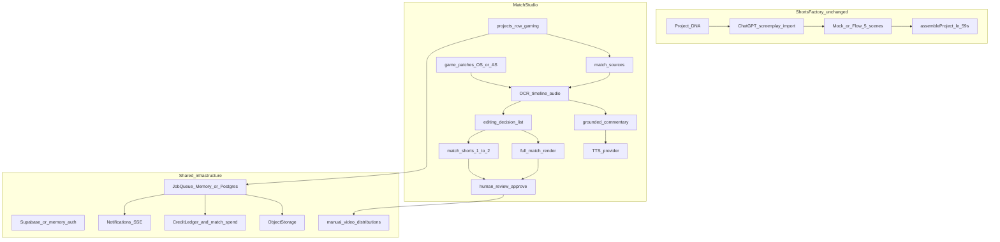
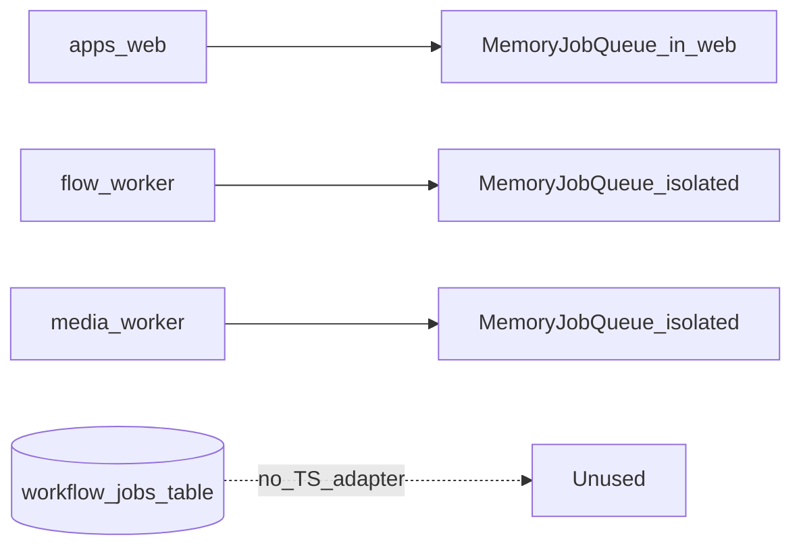
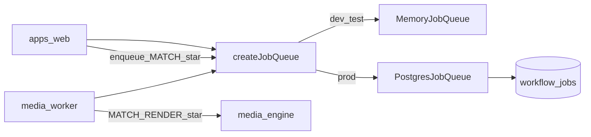

# Match Studio — Architecture

**Scope:** Design boundaries for Gaming Match Studio on AI Shorts Factory.  
**Milestone:** 0 (no code changes).  
**Authority:** Verified against source; see also `SYSTEM_ARCHITECTURE.md`.

---

## 1. Product boundaries



**Rule:** Arrows never route Match Studio VOD bytes through Flow scene generation or shorts `assembleProject`.

---

## 2. Package ownership

| Concern | Package / app | Notes |
|---|---|---|
| Domain repos, KB, match pipelines | `packages/database` | Extend pipelines; Memory + Supabase |
| Zod contracts | `packages/validation` | New match-studio lifecycle + ingest contract |
| Enums / defaults | `packages/shared-types` | Match Studio status enums; do not mutate shorts `BUSINESS_DEFAULTS` semantics |
| Job queue + runners | `packages/workflow-engine` | Add match job types; Postgres adapter (M2); optional match runner module |
| FFmpeg / OCR / match render | `packages/media-engine` | New match ingest contract; full-match render; TTS-agnostic audio mix later |
| Credits | `packages/credit-manager` + `match-spend.ts` | Reuse; TTS/vision spend domains already sketched |
| Storage keys | `packages/storage` | Originals vs derivatives prefixes |
| Commentary prompts (copy/paste) | `packages/chatgpt-import` | Extend polish prompts; no assumed OpenAI API |
| Web UI / actions / upload | `apps/web` | `/match-studio/*` interactive UX |
| Long media / match jobs | `apps/media-worker` | Fix to execute match job types against shared queue |
| Flow generation | `apps/flow-worker` | **Out of scope** for Match Studio VODs |
| Optional orchestration | `packages/n8n-integration` | Optional later; not required for M1–M7 |

---

## 3. Workflow lifecycle (target)

Human-visible Match Studio stages (product FSM — **new**, not shorts `workflow_state`):

1. Created / patch selected  
2. Uploading / ingesting  
3. Metadata validated  
4. Queued for analysis  
5. Analyzing (video / audio / correlation)  
6. Waiting for timeline review  
7. Commentary generating / waiting for commentary review  
8. Voice generating / waiting for voice approval (or skipped if TTS unavailable)  
9. EDL ready / waiting for edit review  
10. Rendering full match  
11. Rendering Shorts  
12. Quality check  
13. Waiting for final approval  
14. Completed / Failed / Cancelled  

Each stage must map to persisted status + optional active `workflow_jobs` row. UI must not show “completed” unless backends agree.

---

## 4. Job-processing architecture

### Today (limitation)



### Target (Milestone 2+)



**Adapter requirements:**

- Implement existing `JobQueue` methods + add `cancel(jobId, actor)`.
- Idempotent `enqueue` via `idempotency_key`.
- Claim with lease + heartbeat; reclaim expired leases (already tested for memory).
- Service-role / worker credentials for lease mutations (RLS in `00003` expects this).
- Persist progress artifact refs in job `payload` or dedicated progress table (M2 design preference: payload + match_source status columns).

**media-worker fix plan (M2):**

1. Wire shared `createJobQueue()` + object storage + match repositories (same pattern as web runtime singletons).
2. Handle new match job types (`MATCH_INGEST_PROBE`, `MATCH_RENDER_FULL`, `MATCH_RENDER_SHORTS`, etc.).
3. Leave intentional fail path for shorts `ASSEMBLE_PROJECT` **or** implement shared assemble later — **do not** block Match Studio on fixing shorts assemble in-worker if web tick remains the shorts path.
4. Smoke mode remains for local FFmpeg proof without credits.

---

## 5. Media architecture

| Path | Entry | Limits | Output |
|---|---|---|---|
| Shorts factory assemble | `assembleProject` | ≤59s, 5 scenes | Vertical short |
| Flow manual import | `DEFAULT_FLOW_IMPORT_MEDIA_CONTRACT` | 1–20s | Scene asset |
| Match ingest (new) | `MATCH_INGEST_MEDIA_CONTRACT` | Configurable long duration/size | Preserved original + metadata |
| Match condensed (today) | `renderMatchEdit` profile condensed | default 180s / max 600s | Highlight reel (video-only today) |
| Match Shorts (today) | `renderMatchEdit` profile short | ≤59s × ≤2 | Vertical shorts |
| Full-match (M6) | New renderer | Preserve + speed + narration mix | Complete edited match |

**Storage layout (proposed):**

```text
users/{userId}/match-studio/{projectId}/
  original/{recordingId}/source.mp4
  derivatives/{recordingId}/frames/...
  derivatives/{recordingId}/ocr/...
  derivatives/{recordingId}/audio/...
  outputs/{recordingId}/full-match.mp4
  outputs/{recordingId}/short-1.mp4
  outputs/{recordingId}/short-2.mp4
  voice/{recordingId}/segment-*.wav
```

Never overwrite `original/`.

---

## 6. Game Knowledge vs Project DNA

| | Project DNA | Game Knowledge |
|---|---|---|
| Purpose | Brand/creative continuity for generative shorts | Factual game data for match intelligence |
| Storage | `project_dna_versions.snapshot` | `game_profiles` → patches → heroes/abilities |
| Environments | N/A | `original` \| `advance` (strict) |
| Activation | Publish DNA version | Publish patch + bind with environment match |
| Match Studio | Unused for facts (optional brand cosmetics later) | **Required** for grounded commentary |

---

## 7. Provider interfaces (design)

Keep core domain free of vendor SDKs:

| Interface | Package home (proposed) | Default |
|---|---|---|
| `OcrProvider` | `media-engine` (exists) | Tesseract / scripted; paid_vision throws until registered |
| `AudioEventDetector` | `media-engine` (new) | Stub with status `not_implemented` or heuristic MVP |
| `CommentaryGenerator` | `database` or small package | Local grounded builder (exists) + optional polish import |
| `TtsProvider` | new under `media-engine` or `packages/tts` | Mock + “unavailable” if unset |
| `VisionProvider` | extend OCR factory | Gated by `MATCH_PAID_VISION_ENABLED` |

---

## 8. UI architecture

- Evolve from docs page [`/match-analysis`](apps/web/src/app/match-analysis/page.tsx) to interactive **`/match-studio`**.
- Reuse `requireUser`, AppShell nav, notification patterns, server actions.
- Keep `/game-knowledge` as KB management surface.
- Do not pretend CLI-only steps are finished product features; show capability status badges (`supported` / `partial` / `unavailable`).

---

## 9. Security and isolation

- User-scoped RLS patterns already on match_* and game_* tables.
- Workers use service role for lease updates; never expose service role to browser.
- OS/AS enforcement at every pipeline entry (`assertCanActivatePatch` / environment match).
- Spend confirmation for paid domains.

---

## 10. Trade-offs

| Decision | Trade-off |
|---|---|
| Reuse `projects` for Match Studio | Couples match to content-platform project model; avoids nullable `workflow_jobs.project_id` migration |
| Postgres queue not Redis | Fits existing schema/ops; slightly more SQL contention than Redis |
| Visual-first analysis | Faster ship; audio/scoreboard gaps require honest UI |
| Separate full-match renderer | More code than stretching condensed edit; correct product semantics |
| No multi-tenancy | Matches current product; revisit as separate milestone if needed |
