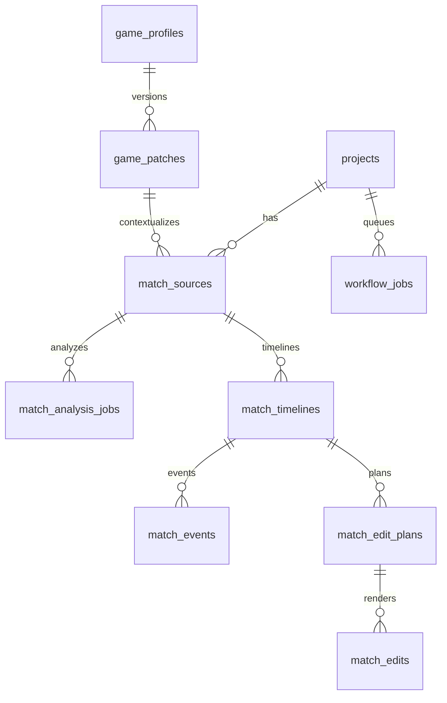

# Match Studio — Data Model

**Milestone:** 0 (design only).  
**Rule:** Prefer additive migrations. Do not fork Game Knowledge or Shorts schemas.

---

## 1. DNA vs Game Knowledge (non-negotiable)

| Concern | Store in | Do not store in |
|---|---|---|
| Brand voice, visual style, storytelling prefs | `project_dna_versions` | Game patches |
| Patch code, heroes, abilities, OS/AS facts | `game_patches` / `hero_knowledge` / `ability_knowledge` | Project DNA `universe_context` dumps |
| Match recording bytes + metadata | `match_sources` + object storage | Scene `generated_assets` Flow path |
| Generative 5-scene shorts | `scenes` / Flow jobs | Match Studio pipeline |

---

## 2. Entities that already exist (authoritative)

### Content platform / shorts

- `users`, `projects`, `project_inputs`, `stories`, `story_versions`
- `project_dna_versions`, `videos`, `environments`, `characters`, …
- `workflow_jobs` (`project_id` **NOT NULL** → `projects`)
- `video_distributions`, `social_accounts`

### Game knowledge (`00008_game_knowledge.sql`)

```text
game_profiles
  └── game_server_profiles (environment: original | advance)
  └── game_patches (unique profile + environment + patch_code)
        ├── knowledge_sources
        └── hero_knowledge
              └── ability_knowledge
```

`projects` already has nullable `game_profile_id`, `active_game_patch_id`, `active_server_environment` (see migration 00008).

### Match plane (`00009`–`00012`)

| Table | Role |
|---|---|
| `match_sources` | Recording identity; `local_path` / `storage_key`; **requires** `game_patch_id` + `server_environment` |
| `match_analysis_jobs` | Roster OCR jobs + cache_key |
| `match_timelines` | Timeline header + status |
| `match_events` | Timestamped events, evidence jsonb, windows, human vs detector source |
| `match_edit_plans` / `match_edits` | Condensed + Shorts plan/render/approve |
| KB sync / spend / cache metrics | Automation controls |

**Gap:** `match_sources` has **no** `project_id` today.

---

## 3. Target Match Studio domain (Milestone 1+)

### 3.1 Project binding (locked)

Each Match Studio match uses:

1. A `projects` row with `category = 'gaming'` (existing enum value).
2. Project game-KB columns set for profile / environment / active patch (or explicit unknown — see §5).
3. One or more `match_sources` rows linked via **new** `project_id uuid references projects`.



DNA versions may exist for the project (platform bootstrap) but **must not** drive commentary facts.

### 3.2 Match Studio lifecycle status (new)

Add shared-types enum, e.g. `MATCH_STUDIO_STATUSES`:

`draft` → `awaiting_upload` → `ingesting` → `ready_for_analysis` → `analyzing` → `awaiting_timeline_review` → `commentary_pending` → `awaiting_commentary_review` → `voice_pending` → `awaiting_voice_approval` → `edl_pending` → `awaiting_edit_review` → `rendering` → `awaiting_final_approval` → `completed` | `failed` | `cancelled`

Persist on `projects` via new column **or** dedicated `match_studio_sessions` table.

**Recommendation (M1):** additive `match_studio_state` (+ `match_studio_error`) on `projects` when used as Match Studio, **or** a thin `match_studio_runs` table keyed by `project_id` + `match_source_id` to avoid overloading shorts workflow_state. Prefer **`match_studio_runs`** to keep shorts `workflow_state` untouched.

Proposed `match_studio_runs`:

| Column | Type | Notes |
|---|---|---|
| id | uuid PK | |
| project_id | uuid FK projects | |
| match_source_id | uuid FK match_sources | |
| status | text/enum | Match Studio FSM |
| patch_resolution | `bound` \| `unknown` \| `draft_only` | See §5 |
| last_error | text | |
| capability_flags | jsonb | e.g. `{ tts: "unavailable", audio_events: "stub" }` |
| created_at / updated_at | timestamptz | |

### 3.3 Recording extensions (M1–M2)

Additive on `match_sources` (or companion `match_recording_meta`):

| Field | Purpose |
|---|---|
| `project_id` | Link to Match Studio project |
| `storage_key` | Prefer object storage over only `local_path` |
| `content_checksum_sha256` | Already present — keep as cache identity |
| `probe_json` | duration, width, height, fps, codecs, audio streams |
| `ingest_status` | uploaded / validated / failed |
| `byte_size` | Already present |
| `original_filename` | Operator display |
| `duration_seconds` | Already present |

Do **not** apply Flow 20s limits here.

### 3.4 Later additive entities (M3–M6)

| Entity | Milestone | Purpose |
|---|---|---|
| `match_audio_events` | M3 | Timestamped audio cues + confidence + evidence |
| Commentary segment table or versioned jsonb | M5 | Styles, approval, evidence refs (extend script schema) |
| `match_tts_assets` | M6 | storage_key per segment, voice config, spend refs |
| `match_edl_decisions` | M6 | Explicit EDL rows (or versioned plan jsonb with review fields) |
| Hero aliases / items / emblems tables | M4 | Only if JSON terminology proves insufficient |

Preserve detector vs human: `match_events.source` already supports `detector` \| `human`; keep original rows or evidence history when correcting.

---

## 4. Game Knowledge completeness vs product ask

| Requirement | Today | Plan |
|---|---|---|
| Game → env → patch → heroes → abilities | Yes | Reuse |
| OS vs Advance separation | Yes | Reuse activation |
| Hero aliases | No dedicated field | M4: `aliases text[]` on `hero_knowledge` or terminology map |
| Roles / lanes | Yes (`roles`, `lanes`) | Reuse |
| Ability icons | No dedicated column | M4: optional `icon_asset_id` |
| Items / battle spells / emblems | Missing | M4 additive tables under patch **or** structured jsonb with Zod — prefer tables if query/filter needed |
| Patch publish / immutable | Yes | Reuse phrase `PUBLISH_GAME_KNOWLEDGE` |
| Markdown import | Not found | M4: optional converter → same JSON schema; do not invent parallel store |
| Auto Moonton sync | Explicitly not called | Keep artifact sync non-publishing |

---

## 5. Unknown patch strategy (acceptance scenario)

Today `ingestMatchVideoSchema` **requires** `game_patch_id`.

**Target (M1):**

1. User may select **Unknown patch** explicitly.
2. Persist `patch_resolution = unknown` on the run.
3. Analysis may proceed for structure/OCR with **reduced** commentary (no ability claims from KB).
4. Commentary generator must refuse unevidenced ability/patch claims; UI shows limitation.
5. User can later bind a published patch and re-run knowledge-dependent stages without re-uploading (checksum cache).

Never silently fall back to Advance knowledge when Original is selected.

---

## 6. Migration sequence (planned, not executed in M0)

| Migration | Milestone | Change |
|---|---|---|
| `00013_match_studio_lifecycle.sql` | M1 | `match_sources.project_id`; `match_studio_runs`; indexes; RLS |
| `00014_match_recording_probe.sql` | M2 | probe_json / ingest_status / original_filename if not in 00013 |
| `00015_match_audio_events.sql` | M3 | audio events table |
| `00016_game_knowledge_extensions.sql` | M4 | aliases, optional items/spells |
| `00017_match_tts_and_edl.sql` | M6 | TTS assets + EDL review fields |

Exact numbering may shift if other migrations land first — always append.

---

## 7. Soft delete, versioning, tenant isolation

- User isolation via `user_id` + RLS (existing pattern).
- Soft delete: follow `deleted_at` where present on sources/projects.
- Patch immutability after publish (existing).
- DNA versioning remains for shorts; Match Studio run status is separate.
- No org/tenant tables in v1.

---

## 8. What must not change

- Shorts `scenes.scene_number` 1–5 uniqueness.
- `BUSINESS_DEFAULTS.finalVideoMaxSeconds = 59` for generative assemble.
- `DEFAULT_FLOW_IMPORT_MEDIA_CONTRACT` defaults.
- OS/AS unique constraint on patches.
- Manual distribution semantics.
