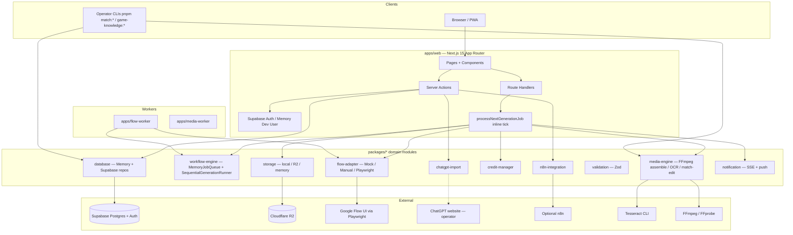
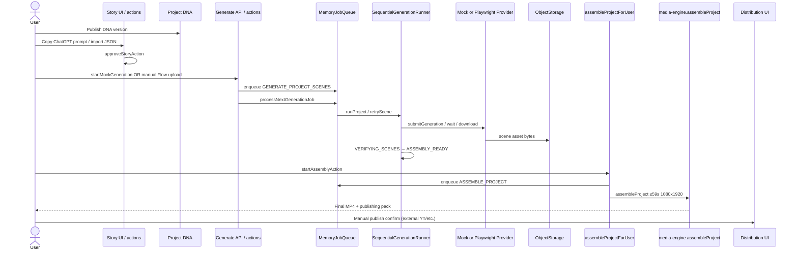
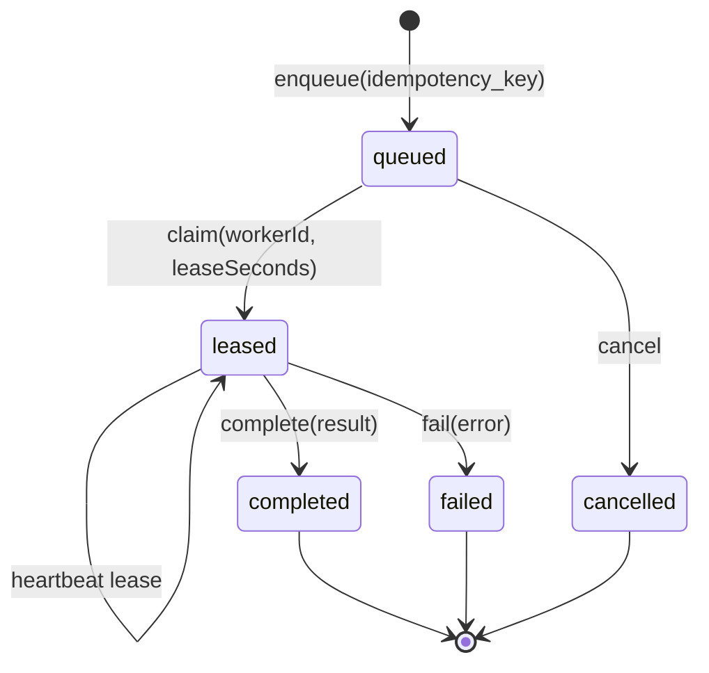
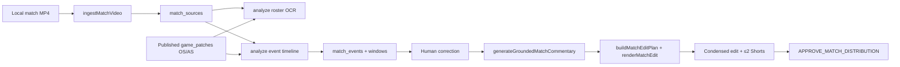
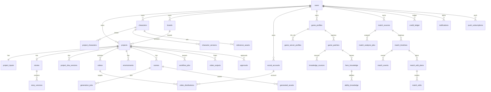

# SYSTEM ARCHITECTURE

Evidence-based architecture diagrams and integration boundaries for **AI Shorts Factory** (`D:\repos\personal\ai_shorts_factory`).

---

## 1. High-level system architecture

**Key architectural facts**

- Primary product path is a **modular monolith** in `apps/web` with in-process job ticks.
- Workers exist but use **separate process-local** `MemoryJobQueue` instances — they do not share the web queue.
- `workflow_jobs` Postgres table exists; **no TypeScript Supabase queue adapter** is present.
- MLBB match intelligence is a **parallel subsystem** (packages + CLIs + docs UI), not wired into the 5-scene Flow project lifecycle.

---

## 2. Video-generation workflow (shorts factory)

**State machine (project):** `packages/database/src/workflow-transitions.ts`  
`IDEA_SUBMITTED` → story states → `READY_FOR_GENERATION` → `CREDIT_RESERVED` → `GENERATING_SCENES` → `VERIFYING_SCENES` → `ASSEMBLY_READY` → `ASSEMBLING` → `QUALITY_CHECK` → `COMPLETED` (optional `FINAL_APPROVAL` / `APPROVED`).

---

## 3. Job-processing workflow

| Job type | Primary consumer | Notes |
|---|---|---|
| `GENERATE_PROJECT_SCENES` | web inline tick; flow-worker | Web always uses mock provider |
| `RETRY_SCENE` | flow-worker / runner | Payload includes scene number |
| `VERIFY_SINGLE_SCENE` | flow-worker canary | `maxScenes: 1` |
| `ASSEMBLE_PROJECT` | web media tick | media-worker **fails** real jobs pending shared adapters |

Sources: `packages/workflow-engine/src/job-types.ts`, `memory-job-queue.ts`, `apps/web/src/lib/generation/process-job.ts`, `apps/media-worker/src/index.ts`.

---

## 4. MLBB match-intelligence workflow (parallel)

Entry points: `scripts/analyze-match-roster.mjs`, `analyze-match-timeline.mjs`, `generate-match-commentary.mjs`, `assemble-match-edit.mjs`; libraries under `packages/database/src/match-*.ts` and `packages/media-engine`.

---

## 5. Database ER diagram (core + content platform + MLBB)

Schema sources: `packages/database/migrations/00001_init.sql` … `00012_kb_sync_and_spend.sql`.

---

## 6. Integration boundaries

| Boundary | Inside system | Outside / operator | Contract |
|---|---|---|---|
| Story LLM | Prompt builder + Zod import | ChatGPT website | JSON screenplay-v1 |
| Video gen | Provider interface | Google Flow UI | Playwright recipe / manual upload |
| Credits | credit-manager ledger | Google Flow account balance | Reserve/confirm; live spend phrase |
| Object bytes | storage keys | Local disk or R2 | `createObjectStorage()` |
| Auth identity | `AppUser` | Supabase Auth | JWT cookies / memory bypass |
| Orchestration | Event emit | n8n workflows | HMAC webhooks |
| Match OCR | Frame sample + OCR provider | Tesseract binary / future vision API | `OcrProvider` |
| Publishing | Distribution records | YouTube/TikTok/etc. apps | Manual URL confirm |
| Game KB | Import/publish repos | Operator research JSON / artifact sync | Never auto-publishes |

---

## 7. Important dependencies (versions from manifests)

| Dependency | Version / note | Where |
|---|---|---|
| Node | ≥20 (`.nvmrc` = 20) | engines |
| pnpm | 9.15.0 | `packageManager` |
| Turborepo | ^2.3.3 | root `devDependencies` |
| TypeScript | ^5.7.2 | root + apps |
| Next.js | ^15.5.7 | `apps/web` |
| React | ^19.0.0 | `apps/web` |
| Tailwind | ^3.4.1 | `apps/web` |
| Zod | ^3.24.1 | web + validation |
| Vitest | ^2.1.8 | monorepo |
| `@supabase/ssr` / `supabase-js` | ^0.5.2 / ^2.49.1 | web |
| AWS S3 SDK (R2) | via `packages/storage` | R2 provider |
| Playwright | flow-adapter live path | Google Flow automation |
| n8n (Docker) | 1.72.1 | `docker/n8n/docker-compose.yml` |
| FFmpeg / FFprobe | system binaries | media-engine |
| Tesseract | system CLI optional | media-engine OCR |
| Prisma / Drizzle | **not used** | raw SQL migrations |

---

## 8. Recommended extension seams for MLBB productization

1. **Keep** shorts factory project workflow isolated; add match jobs as new `WORKFLOW_JOB_TYPES` rather than overloading `GENERATE_PROJECT_SCENES`.
2. **Reuse** `media-engine` (`sampleFramesAtTimestamps`, `cropNormalizedRegion`, `renderMatchEdit`, OCR factory).
3. **Reuse** game KB activation (`assertCanActivatePatch`) for OS vs Advance binding.
4. **Extend** storage + introduce durable queue before long VOD processing in workers.
5. **Do not** overload Project DNA with hero/patch facts — use `game_patches` / `hero_knowledge`.
6. **Publish** remains manual until real platform OAuth clients are added behind distribution statuses.
